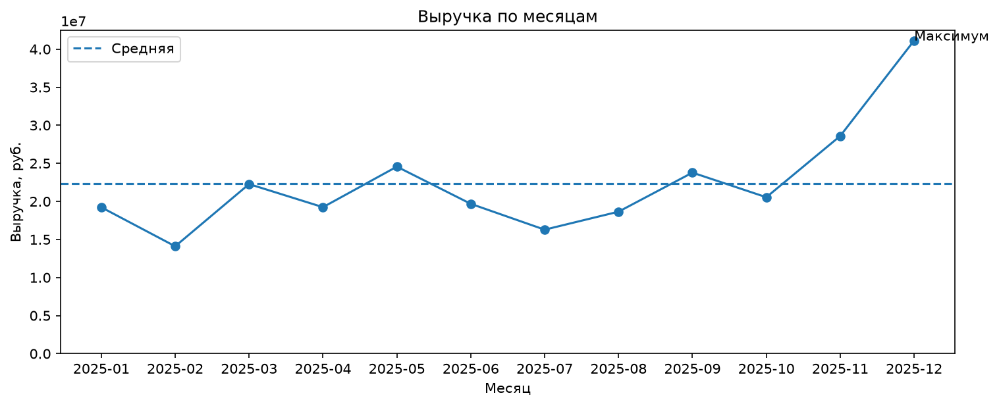
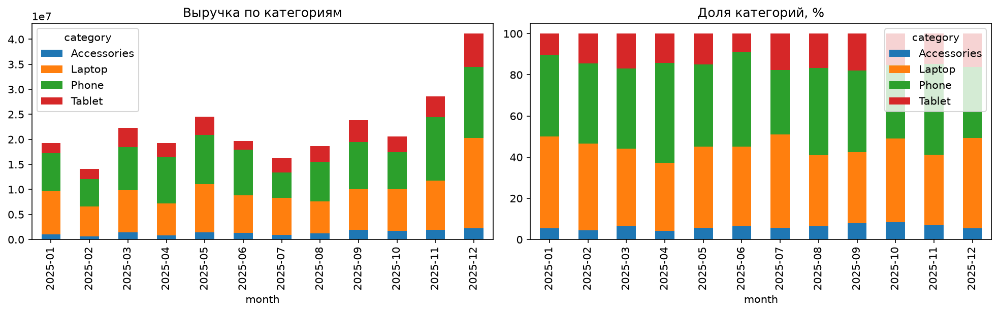
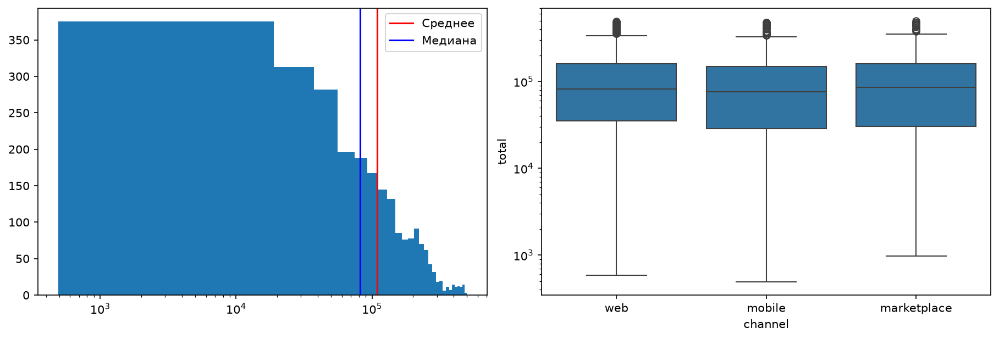

# Лабораторная работа № 5

## Тема

Визуализация данных интернет-магазина средствами Matplotlib, Seaborn и Plotly.

## Состав лаборатории

- `Python__04_ЛР_5.ipynb` — теория, задания 1–20, контрольные вопросы и ответы.
- `sales_report.py` — загрузка и проверка данных, агрегации, графики и HTML-отчёт.
- `img/` — итоговые изображения для README.

Данные и результаты выполнения (`lab5_data/` и `lab5_output/`) генерируются программой и не включаются в репозиторий.

## Типы графиков

| Аналитическая задача | График | Обоснование |
|---|---|---|
| Динамика выручки | Линейный | Показывает изменение показателя по месяцам. |
| Структура продаж | Составные столбцы | Позволяет сравнить сумму и доли категорий. |
| Распределение заказов | Гистограмма и boxplot | Показывают форму распределения, медиану и выбросы. |
| Активность покупателей | Тепловая карта | Наглядно показывает сочетание дня недели и часа. |
| Продажи по городам | Интерактивная карта Plotly | Даёт масштабирование и подсказки по городам. |

## Запуск

```bash
python sales_report.py
```

Скрипт возвращает код `0`, если все графики построены, и создаёт `lab5_output/report.html`.

## Итоговые графики







## Ссылка на репозиторий

https://github.com/sedergsoft/python-labs-gutierrez
